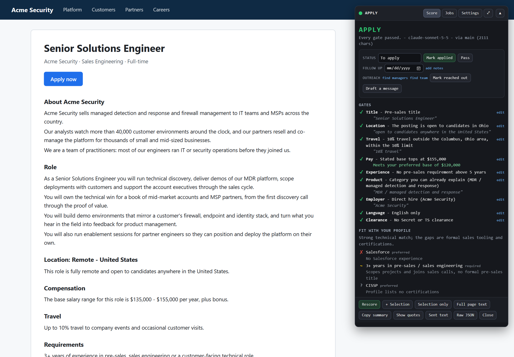
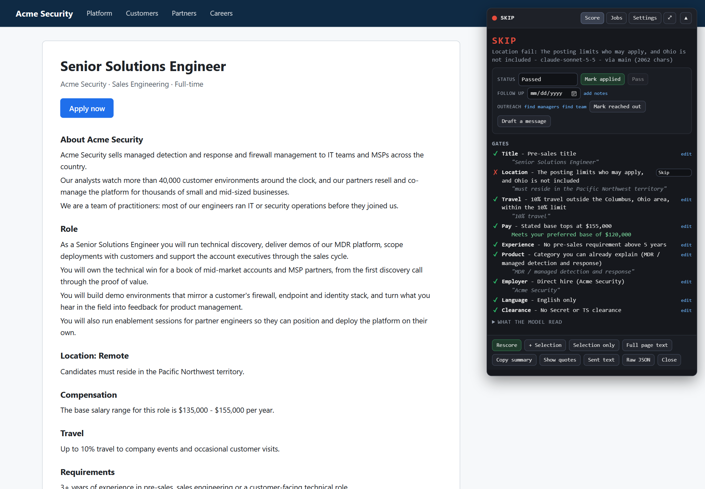
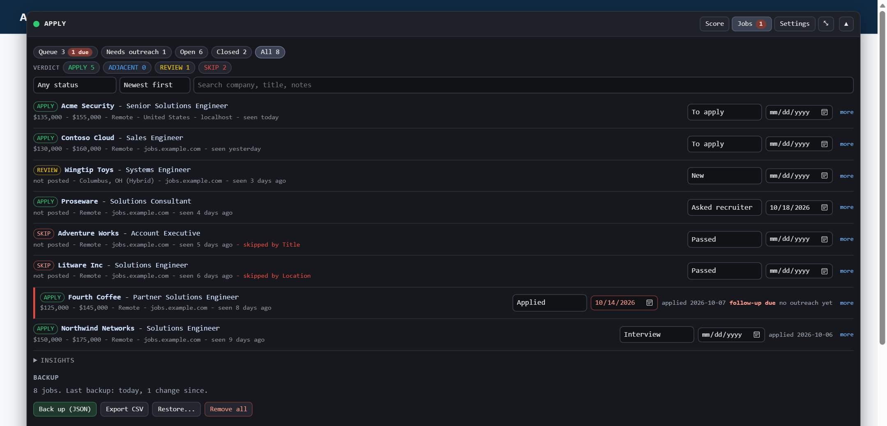
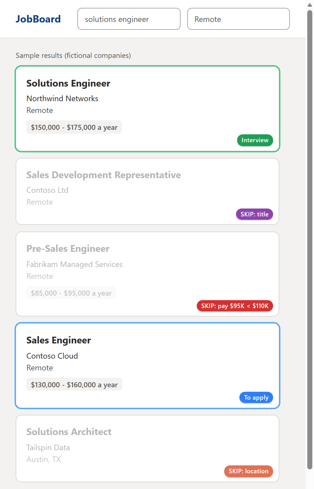

# JobScore

**Reads the job posting you are looking at and tells you whether to apply, without you reading every line.**

[](https://github.com/ZachGSnow/jobscore/actions/workflows/ci.yml)
[](LICENSE)
[](https://violentmonkey.github.io/)



## Why

Job alerts bury the few postings worth reading under many that fail on one line you
only find at the bottom: the pay, who may apply, a quota, the travel. JobScore reads
each posting for you and applies **your** rules.

It is built around the hard part of using an LLM for a decision: trusting what it
says. So the model never decides anything. It **extracts facts**, each with a
verbatim quote. Code **checks every quote against the page** and throws away any
fact it cannot find. Then plain, tested code **judges the facts against your
settings**, which you edit in the panel.

```
posting page
    |
    v
scrape the posting text (site selectors, then fallbacks)
    |
    v
LLM extracts facts, each with a verbatim quote
    |
    v
code checks every quote against the page (no quote, no fact)
    |
    v
gates apply YOUR settings --> APPLY / ADJACENT / REVIEW / SKIP
```

Because the cache holds the extracted **facts**, not verdicts, changing a rule
re-scores instantly with no API call.

## Features

- Scores postings on LinkedIn, Indeed, Built In, Greenhouse, Workday, Lever and Ashby
  automatically, and any other careers page on **Alt+1**.
- Evidence-checked extraction, and **NO SCORE** with the reason instead of a guess
  when the captured text is incomplete.
- Nine editable gates: title, location, travel, pay, experience, product, employer,
  language and clearance. Each outcome can skip, send to review, flag a question for
  the recruiter, or be ignored.
- Works with Anthropic, OpenAI or a local Ollama model.
- Labels the results lists on Indeed and LinkedIn: every card that already fails your
  rules (title, pay shown, place) is faded with the reason ("SKIP: pay $95K < $110K"),
  and jobs you track show their status, with no API call and no clicks.
- A built-in job tracker: statuses, follow-up dates, a queue of what is due, "seen
  before" across sites, backups.
- Fit notes against your profile, and outreach drafts built from facts only.
- Works on strict pages: LinkedIn's whole posting is read even while folded behind
  "... more", and the panel renders under LinkedIn's Trusted Types policy.
- Nothing leaves your browser except the posting text sent to the model provider you
  choose. API keys are never exported.

The shipped settings are a **fictional sample profile**: Jordan, a systems engineer in
Columbus, Ohio, moving into pre-sales. Replace them with your own before you rely on a
verdict.

## Install

1. Install the [Violentmonkey](https://violentmonkey.github.io/) extension (Chrome,
   Edge, Firefox, Vivaldi and other Chromium browsers).
2. Open the [latest release](https://github.com/ZachGSnow/jobscore/releases/latest) and
   click **JobScore.user.js**. Violentmonkey offers to install it. New releases install
   automatically as updates.
3. Open a job posting. A small pill appears top right. Click it, open
   **Settings > Model**, pick a provider and paste an API key (or point it at a local
   Ollama). Reload the tab.
4. Make it yours: **Settings > Pay > Where you work from** (home region, territory
   words including your state name and code, commutable places), and
   **Settings > Profile** for the fit notes.

If no pill appears, open DevTools and look for the `[JobScore] JobScore ready` line. **Settings > Data > Copy panel diagnosis** reports whether the panel is mounted, its size, and how its stylesheet loaded.

## Using it

| You do | What happens |
| --- | --- |
| Open a posting on LinkedIn, Indeed, Built In, Greenhouse, Workday, Lever or Ashby | Auto-scores. The pill shows the verdict. |
| Open any other careers page | Idle if the URL does not look like a job (`/jobs/`, `/careers/` ...). Press **Alt+1** to score it anyway. |
| **Alt+1** | Scores the page. With text selected, scores just the selection. |
| **Alt+2** | Opens the panel on any page (on your jobs, or where you were), or closes it. Scores nothing, so it is free. |
| Click the pill | Expands the panel: verdict, your status for the job, gates, questions to ask, fit notes. |
| **Mark applied** / **Pass** / the status dropdown | Saves your decision on the job at once. Applied sets the date and a follow-up. |
| **Rescore** | Calls the model again (bypasses the cache). |
| **+ Selection** | Adds the text you highlighted to what was scraped (selection goes first). Use it when a selector missed a section. |
| **Selection only** | Scores only the highlighted text. |
| **Full page text** | Scores everything the page shows, not just the description element. |
| **Copy summary** | A paste-ready note: company, title, verdict, pay, questions, URL. |
| **Copy as a message** | The recruiter questions as a short first message. |
| **Show quotes / Sent text / Raw JSON** | See the verbatim page wording behind each fact, the exact text sent to the model, and the model's reply. |

The panel is draggable, and the **⤢** button makes it a large overlay (the Jobs table
wants the room). The Violentmonkey menu has three entries: score this page, jobs
and follow-ups, settings. Everything else (selector report, backups, cache, panel
position) is under **Settings > Data**.

## The verdicts

| Verdict | Meaning |
| --- | --- |
| **APPLY** | Every gate passed. |
| **APPLY · ask** | Passed, but something is worth asking the recruiter. The panel lists the questions. |
| **ADJACENT** | A title like Technical Account Manager: not pre-sales, but you want to see it. |
| **REVIEW** | The tool could not resolve something it needs. Usually a scrape gap. |
| **SKIP** | A gate you set to *skip* failed. The reason names the gate and quotes the page. |

"No pay listed" is **not** a skip by default: it is APPLY plus the question
*"What is the base salary range?"*. Change that in Settings.



## Tracking your jobs

Every posting you score is saved as a **job** with its verdict, pay, the questions
to ask, a stable link, and what you do about it. This is a small tracker, not a
replacement for everything a tracker app does: it does not hold contacts, resume
versions or interview scheduling, and it does not autofill applications.



**Statuses:** New, To apply, Asked recruiter, Applied, Follow up, Interview, Offer,
Passed, Rejected, Closed. A fresh APPLY or ADJACENT starts as *To apply*, a SKIP as
*Passed*, anything else as *New*. A status you did not set follows the verdict if
the verdict changes (loosen a rule and a passed job reopens). A status you set
yourself is never overwritten.

**Applying and follow-ups.** Marking a job **Applied** records the date and sets a
follow-up date 7 days out (change the number in Settings > Tracker, or edit the
date on the job). *Asked recruiter* sets one too. A follow-up is **due** on its
date while the job is Asked, Applied or Follow up; due jobs show a count on the
Jobs tab (and on the collapsed pill) and sit in your **Queue**.

**Seen before.** When you open a posting you already scored, the Score view says so:
"You already applied" (with the date), what the verdict was and whether it has
changed. It also catches the **same job on another site**: LinkedIn, Indeed and
Built In alerts for one role share a company and title, so the second one tells you
what you did with the first.

**On Indeed and LinkedIn result lists** every card JobScore can judge gets a
small coloured label, so the list reads at a glance without hovering:



The checks use your current settings (title keywords, pay floor and where it is
compared, home region), and a settings change re-checks the visible cards at once.
A card is only faded when that gate's outcome is set to *skip*.

| Label | Colour | Meaning |
| --- | --- | --- |
| `SKIP: title` | purple | The card's title fails your title rules (no API call) |
| `SKIP: pay $80K < $125K` | red | The pay on the card tops out under your floor |
| `SKIP: location` | orange | The place on the card rules it out |
| `Passed (Pay)` | grey | You passed on it, or its full score was a SKIP |
| `Applied 10-12` / `Interview` / `Offer` | green | You are pursuing it (outlined in green too) |
| `To apply` / `Asked recruiter` / `Follow up` | blue | On your list (outlined in blue) |
| `Needs a look` | amber | Scored, no decision yet |

SKIP and Passed cards are faded, but only their contents: the label stays readable.
The label is drawn with CSS from an attribute on the card, so no element is ever
added to the site's page, and it never blocks a click. Switch labels, outlines or
the cheap-gate dimming off in Settings > Tracker and Settings > Model > Behaviour.

**The Jobs tab** opens on your **Queue** (to apply, plus anything due). Click a
verdict chip, a status, or a bar under *Insights > What skips you* to filter, search by
company, title or notes, and sort by newest, follow-up date, company or pay. The
company and title are a link that reopens the posting (Indeed and LinkedIn links are
rebuilt as direct posting links, because the address bar on a search page only
reopens the search). Each row has a status, follow-up date, notes, a *Copy tracker
line* button, and *Remove*.

**Outreach.** Each job has **find managers** and **find team** links that open a LinkedIn
people search in a new tab (the company plus a manager keyword for the seat, and
the company plus the job's own title, for peers who can refer you). They are plain
links: nothing is fetched or read from the results. **Mark reached out** records the
date, and the **Needs outreach** view on the Jobs tab lists every job you have applied
to and not yet messaged, which makes a good weekly batch.

**Draft a message.** Once you have found a person, **Draft a message** writes a first
note to them: a hiring manager, someone on the team, or a recruiter, as a short
connection note (fits LinkedIn's limit, 200 characters by default) or a fuller
message. It is built from facts only, with no model call: your own one-line intro
(Settings > Tracker), a product you listed as familiar (so "I have hands-on
experience with Veeam" appears only if Veeam is in your known products), and the
strengths the fit notes confirmed. For a recruiter it also asks the first question
JobScore flagged, such as the base salary range. Edit the text, then **Copy** or
**Copy + mark reached out**. Read it before you send it.

**Other trackers.** *Copy tracker line* (one job) and *Copy summary* paste into a
note in any tracker app, and the CSV export has plain columns (company, title, URL,
status, date applied, follow-up, pay, location, notes) for a spreadsheet.

### Keeping your data

Jobs are stored in Violentmonkey's storage for this browser profile. Clearing the
browser cache does not normally touch it, but **deleting the script in
Violentmonkey, resetting the profile, or reinstalling the browser can** (I believe
removing a script also removes its stored data, so export before you remove it).

- **Back up (JSON)** in the Jobs tab or Settings > Data writes
  `jobscore-backup-<date>.json` (jobs and settings, never API keys) to your
  Downloads folder.
- The Jobs tab **reminds you** when it is time: after 7 days with changes, or 25
  changes, or 5+ jobs and no backup yet (all adjustable in Settings > Tracker).
- **Restore** from a backup file or pasted JSON: *Merge* keeps whichever copy of a
  job changed most recently (so an old backup never undoes newer work); *Replace*
  makes the file the truth.
- Nothing deletes automatically. *Remove all* asks you to type DELETE.
- Violentmonkey's own dashboard export can include script data too; worth turning on
  as a second copy.

## Settings

Everything below is editable in **Settings** and saved immediately (Violentmonkey
storage, this browser only). Each field shows **modified** when it differs from the
default and has a **reset** link. Export and import are in **Settings > Data**;
API keys are never part of an export.

Every gate has a *what to do* dropdown for each outcome:

| Choice | Effect |
| --- | --- |
| **Skip** | The verdict becomes SKIP. |
| **Review** | The verdict becomes REVIEW. |
| **Flag + ask** | The verdict stays; a question is added for the recruiter. |
| **Ignore** | Hidden. |

You can change a gate's dropdown **right on its row** in the verdict view and watch
the verdict update.

### Defaults

These are the sample profile's values; every one is a setting.

| Gate | Default |
| --- | --- |
| **Title** | Pre-sales titles pass (Solutions / Sales / Systems / Customer / Partner / Channel Engineer, Solutions Consultant or Architect, pre-sales). "Systems Engineer", "Customer Engineer" and similar pass only if the model also reads the role as pre-sales. Principal, Lead, Staff, Director, Manager, Account Executive, SDR/BDR, support, implementation, and quota-carrying roles fail. TAM / Customer Success Engineer are ADJACENT. |
| **Location** | Remote **and open to your home state** passes. Hybrid or onsite passes if the office is in your metro (sample: Columbus, Ohio). Anything else fails. If who may apply is not stated, it is a flagged question. The home state is read from your territory words, so it works for any US state. |
| **Travel** | Max **10%** outside your metro, **50%** inside it. Optional switch: fail any customer-site travel outside your metro. Unstated amount or place is a flagged question. |
| **Pay** | Floor **$110,000**, held against the **top** of the base range by default; switch it to the **midpoint** or **bottom** in Settings > Pay. A range that starts under the floor is flagged either way. **$120,000** preferred is shown as "meets preferred" and never gates. No base posted = flag + ask. A range starting under the floor = flag. OTE is displayed, never gated. |
| **Experience** | More than **5** years of pre-sales required fails. Sales-method words (MEDDPICC, etc.) raise a flag. |
| **Product** | Blocked product words fail. An unfamiliar product is a flagged question, not a skip. |
| **Employer / Language / Clearance** | Contract or staffing firm, a required non-English language, or a security clearance fail. Each has an editable word list. |

Other settings: your **home region and commutable places**, the **profile** text
used for fit notes, **provider and model**, and behaviour toggles (auto-score,
all-sites, card prefilter, fit notes).

### Fit notes

After a non-SKIP verdict, a second small call compares the posting's requirements
with your profile and lists what you meet, partly meet, lack, or the profile does
not say. It is the model's reading of your profile, shown for information, and it
never changes a verdict. It sees only the requirement list and your profile, so
editing your profile never re-reads a posting. Turn it off in Settings > Model.

## How a posting is read

| Step | Who | Where |
| --- | --- | --- |
| Pick the posting text (site selectors, then generic fallback, then `ld+json`) | code | `src/extract/` |
| Refuse to score a bad capture before any API call | code | `extractionIssues()` |
| Extract facts as JSON with a quote each (temperature 0) | model | `src/llm/prompt.js` |
| Check every quote is on the page; drop the field if not | code | `verifyEvidence()` |
| Cross-check the facts against the captured text | code | `factCrossChecks()` |
| Turn facts into gates and a verdict, using your settings | code | `src/core/gates.js` |
| Compare requirements with your profile (informational) | model | `runFitNotes()` |

The model decides **nuance** (who may apply, what the office arrangement is, what
the travel is for, what the requirements are). Code keeps the old text rules only
as a **cross-check**: when the page wording disagrees with the model, you get a
flag to confirm, and the verdict follows the model.

A field the model paraphrased instead of quoting is thrown away and scored as
unknown. That reads **quoted but not found** in the panel, which is different from
**(not stated)**, where the posting really does not say. Several of those on one
posting mean the model is too weak for the job: pick a stronger one in Settings.

### When it refuses to score (NO SCORE)

A scrape that missed the description, a collapsed "... more" posting, or an Indeed
pane still showing the previous job produces **NO SCORE** with the reason, not a
guess. The fixes are **+ Selection**, **Selection only**, or **Full page text**.
A SKIP that a missing paragraph could not have changed still stands, with the gap
listed under *Check the extraction*.

### Pay

The Pay gate reads the model's `base_min` / `base_max` / `base_source`, because
only the model can do arithmetic: `$150k-$175k OTE with a 75/25 base to commission
split` is a base of **$112,500 - $131,250**.

- `stated`: the posting names a base.
- `derived_from_ote`: an OTE and a split were both given; the working is shown.
- `not_stated`: no base and no split. The model leaves it blank; an OTE figure is
  never promoted into a base.

If the pay section of the page was never captured (Indeed's *Job details* box),
that is a scrape gap and a REVIEW, not "no pay listed".

## Cost and storage

- Extractions are cached for 14 days by canonical URL (LinkedIn and Indeed key on the job id, so clicking through a results list reuses hits).
- The cache is tagged with provider and model, so switching models re-reads.
- Fit notes are cached per posting and profile.
- Every real score is saved as a job (see *Tracking your jobs*). Jobs are never trimmed, unlike the 14-day cache. *Insights* on the Jobs tab shows what skips you most and what raises the most questions. Nothing leaves your browser except the posting text sent to your chosen provider.

## Adding or fixing a site

Edit `SITE_SELECTORS` in [`src/extract/sites.js`](src/extract/sites.js): a `match` host regex, then `description`, `title`, `company` and `location` selectors. Add an `@match` line in [`vite.config.js`](vite.config.js) if the host is new, and an `@connect` line only for a new API host. For a board that shows a results list next to the open job (Indeed's two-pane search), mark the entry `strict: true` with a `paneRoot` so nothing is ever read from outside the open pane.

To get a selector fixed, press **Copy selector report** on the page (Settings > Data, or the menu). It lists which selectors matched, the largest text blocks, and the first 500 characters sent to the model.

### Site support

Every board below was verified (October 2026) by running the real extractor against
real postings: live public pages from several employers, and saved signed-in pages for
Indeed and LinkedIn. Each has a regression test with a fixture that copies the page's
structure (`test/scrape.test.js`).

| Site | Status | How it is read |
| --- | --- | --- |
| **Greenhouse** | Verified | The new `job-boards` layout, legacy `boards` links and the embedded `job_app` iframe: `.job__title`, `.job__location`, `.job__description`. No employer element, so the name comes from the board path or `?for=`. The document is wiped about a second after load; the panel re-mounts itself. |
| **Workday** | Verified | `data-automation-id` handles; every location `<dd>` is read once each. The page hydrates in pieces, so an empty body is a retry, not a verdict. |
| **Lever** | Verified | `.content` for the posting, `.posting-headline h2` for the title, location plus the workplace type (Remote / Hybrid / On-site). The employer comes from the page's JobPosting data. |
| **Ashby** | Verified | The stable `ashby-job-posting-*` hooks (its other classes are hashed). The left pane (location type, compensation) is sent as its own block, because pay is often only there. |
| **Built In** | Verified | `[id^="job-post-body-"]`. Remote work and pay are often only in header chips; they are read from the page's JobPosting data instead, never from the chips, which share classes with the "similar jobs" cards. |
| **Indeed** | Verified | The two-pane search results page. Read entirely from the open pane; the pane's job key is compared with `vjk` in the URL so a stale pane is never scored. Pay comes from the *Job details* block. Result cards are labelled. |
| **LinkedIn** | Verified | Search results pane and single job page. The posting comes from the `JobDetails_AboutTheJob_<job id>` section, which holds the whole text even while it is folded behind "... more", so no click is needed. The header (title, company, location plus Remote / Hybrid / On-site) is read by its shape inside the details pane, never from a results card. The job id must match the URL (`currentJobId` or `/jobs/view/<id>`), so a pane still showing the previous job is never scored. Result cards are labelled. |
| **Any other site** | Generic | Site selectors, then generic selectors, then the page's own JobPosting description if it holds a fuller posting. |

The JobPosting structured data (remote work, salary) is sent to the model and is
part of the evidence that quotes are checked against, so a fact quoted from it
verifies like any other.

The catch-all `@match *://*/*` also loads the script in every iframe. In an iframe on a host that is not a listed job board, the script does nothing.

## Developing

```bash
npm install
npm test            # vitest: gates, settings, scrapers (jsdom), pipeline pieces
npm run build       # writes dist/JobScore.user.js
npm run watch       # rebuild on save
```

```
src/
  main.js            entry: menu, Alt+1, navigation watchers
  pipeline.js        capture -> cache | model -> verify -> score; fit notes
  debug.js           selector report, panel diagnosis
  core/
    settings.js      defaults, merge/validate, load/save, import/export
    schema.js        the settings form, as data
    gates.js         every gate + the verdict (pure)
    location.js      home-region and metro matching
    enums.js         closed vocabularies
    jobs.js          the tracker: statuses, follow-ups, seen-before, CSV, backups (pure)
    history.js       aggregates, summary and recruiter-message text
    store.js         canonical URL, cache, jobs persistence
    config.js        fixed limits, provider transport, SCHEMA_VERSION
  extract/           site selectors, DOM cleaning, ld+json, coverage checks, cards
  llm/               prompts, normalise + verify, provider requests
  ui/                Svelte panel; host.js is the shadow-root host
test/                gates, settings, scrapers; fixtures.js; harness/ is a manual test page
```

Svelte compiles away at build time and is bundled into the one `.user.js`, so
Violentmonkey just sees a normal script. The panel's CSS is loaded into the shadow
root with `adoptedStyleSheets`, so a page Content-Security-Policy cannot block it.

**Strict pages (Trusted Types).** LinkedIn, Google and others forbid inserting HTML
strings, and LinkedIn also allows only its own Trusted Types policy names. Svelte is
compiled with `fragments: 'tree'`, so the panel is built with DOM calls and the bundle
creates no policy and has no `innerHTML` assignment. `test/bundle.test.js` checks the
built file for both, so the problem cannot come back unnoticed.

**Manual test page.** `node test/harness/serve.mjs` serves a fake posting at
`http://localhost:5179/jobs/x?case=good|nopay|hybrid|territory|ote` that provides
fake GM storage and a canned model reply, so the real bundle and panel can be
exercised with no API key and no Violentmonkey. Add `&csp=tt` to forbid HTML strings
the way Google does, or `&csp=linkedin` to apply LinkedIn's exact policy.

**Changing the extraction.** Bump `SCHEMA_VERSION` in `src/core/config.js` when the
schema, the extraction prompt, or the page scrape changes; that discards cached
extractions built from worse text. Changing a scoring setting never needs this.

**Tests and CI.** `npm test` runs the suite (gates, settings, scrapers on jsdom
fixtures, extraction, outreach, the tracker). Tests use a fixed configuration in
`test/fixtures.js`, so changing the sample defaults never breaks them. GitHub
Actions runs the build and the suite on Windows and Linux for every push and pull
request.

## Updates and your data

Releases install as updates because the script's name and namespace never change, and
Violentmonkey keeps your settings and tracked jobs with that identity. When the
extraction format changes, cached extractions are discarded and each posting is read
once more; your jobs and settings are untouched.

## Manual checks worth one pass

| # | Case | Expect |
| --- | --- | --- |
| 1 | A posting with no pay listed | **APPLY · ask** with "What is the base salary range?" Flip Pay > No base posted to *Skip* on its row: SKIP instantly, no API call. |
| 2 | `$150k-$175k OTE with a 75/25 split` | Pay passes on the derived base, shows the OTE, flags that the range starts under the floor. |
| 3 | A hybrid posting in your metro | Location passes (office in the metro). A hybrid posting in Austin fails. |
| 4 | "Remote, must reside in the Pacific Northwest territory" | SKIP: your home state is not included. |
| 5 | "Remote in New York", nothing about who may apply | APPLY · ask: "Is this open to candidates in <your state>?" |
| 6 | Up to 15% travel to customers in another state | SKIP at the default 10%; passes if you raise it. |
| 7 | A Technical Account Manager posting | ADJACENT. |
| 8 | A posting whose selector misses a section | NO SCORE or a flag; **+ Selection** fixes it. |
| 9 | LinkedIn search: click through several postings | The pill updates per posting; repeat visits show *(cached)*. |
| 10 | Indeed alert, then click another card | No stale verdict from the previous job. |
| 11 | Greenhouse, first two seconds after load | The panel disappears and returns (`re-mounted` in the console). |
| 12 | Kill the network or clear the key | A clear error with a link to model settings. |
| 13 | Mark a posting Applied, then reload it | "You already applied" with the date, and no new API call. |
| 14 | Open the same job from a second site | "Same job elsewhere" with its status. |
| 15 | Set a follow-up to yesterday | The job shows *follow-up due*, the Jobs tab shows a count, and it is in the Queue. |
| 16 | Back up, then Restore with *Merge* | Nothing changes; an old backup never overwrites newer edits. |

## License

[MIT](LICENSE) (c) Zach Snow
